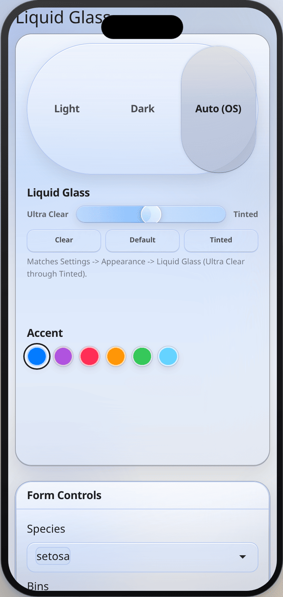

```{r, include = FALSE}
knitr::opts_chunk$set(
  collapse = TRUE,
  comment = "#>"
)
```

This vignette is installed with the package. Open it with `vignette("shinyglass")`. `browseVignettes("shinyglass")` lists it with the other vignettes. The same recipe is `help("shinyglass")`, also available as `help("shinyglass-package")`.

Intensity runs from `0` (Ultra Clear) to `1` (Tinted). The default is `0.5`. Do not pass `material = "clear"`; that argument is deprecated.

# Built for phones

Playwright checks phone-sized viewports (393x852 and 390x852, with touch). On a coarse pointer, the controls those tests measure are at least 44px, including the sidebar toggle and popover triggers. A popover closes on a second tap and on a tap outside. The Harbor notes sidebar toggle and close button both respond. Harbor notes does not scroll sideways at 393x852 or 390x844, and neither do the 480px dashboard and Olympics fixtures. The sources offcanvas opens and closes from its own buttons. The desktop phone frame sets `data-glass-pointer="coarse"` on the framed app, so the preview uses those same sizes.

```{r, echo=FALSE, out.width="280px", fig.alt="Basics demo in an iPhone-sized frame"}

```

```{r}
library(shinyglass)
inherits(glass_theme(preset = "auto", intensity = 0.5), "bs_theme")
```

# Minimal app

`glass_page()` is the one-call page. It includes Light / Dark / Auto, the intensity slider, and accent wells, and it remembers the choices for that path. Call `observe_glass()` in the server.

```r
library(shiny)
library(shinyglass)

ui <- glass_page(
  title = "Hello, glass",
  sliderInput("n", "Bars", 5, 30, 15),
  plotOutput("plot")
)

server <- function(input, output, session) {
  observe_glass(input, session)
  output$plot <- renderPlot({
    pal <- glass_plot_colors(input = input)
    barplot(seq_len(input$n), col = pal$fill, border = NA, col.axis = pal$ink)
  }, bg = "transparent")
}

shinyApp(ui, server)
```

# Add glass to an existing app

Keep the page you already have. bslib `page_sidebar()`, `page_fluid()`, `page_navbar()`, and `page_fillable()` take `theme`. So do `fluidPage()` and `navbarPage()`.

```r
library(shiny)
library(bslib)
library(shinyglass)

ui <- page_sidebar(
  title = "Existing app",
  theme = glass_theme(preset = "auto", intensity = 0.5),
  sidebar = sidebar(
    glass_theme_toggle(),
    glass_intensity_slider()
  ),
  card(
    card_header("Series"),
    plotOutput("plot")
  )
)

server <- function(input, output, session) {
  observe_glass(input, session)
  output$plot <- renderPlot({
    pal <- glass_plot_colors(input = input)
    barplot(seq_len(15), col = pal$fill, border = NA, col.axis = pal$ink)
  }, bg = "transparent")
}

shinyApp(ui, server)
```

The same theme works on `fluidPage()` and `navbarPage()`:

```r
ui <- fluidPage(
  theme = glass_theme(preset = "auto", intensity = 0.5),
  glass_theme_toggle(),
  glass_intensity_slider(),
  plotOutput("plot")
)
```

`glass_theme()` does not persist choices unless you set `persist = TRUE`. `glass_page()` turns persistence on for you.

# Key options

| Argument | Default | Allowed |
| --- | --- | --- |
| `preset` | `"light"` on `glass_theme()`, `"auto"` on `glass_page()` | `"light"`, `"dark"`, `"auto"` |
| `intensity` | `0.5` | `0` to `1` |
| `primary` | `"#007AFF"` | hex, `rgb()`, or a name from `glass_system_colors()` |
| `plot_surface` | `"clear"` | `"clear"`, `"opaque"` |
| `scene` | `"default"` (`"tahoe"` on `glass_page()`) | `names(glass_scenes())` |
| `persist` | `FALSE` (`TRUE` on `glass_page()`) | `TRUE` or `FALSE` |
| `icon_style` | `"clear"` | `"clear"`, `"color"`, `"all"` |
| `floating_sidebar` | `FALSE` | `TRUE` or `FALSE` |
| `refraction`, `morph`, `press`, `scroll_edge`, `minimize_tabs` | `TRUE` | `TRUE` or `FALSE` |

`update_glass_theme(session, ...)` changes these in a running app. Leave an argument `NULL` to keep the current value. Under Auto, color plots with `glass_resolved_preset(input)`, not the string `"auto"`.

# Migrating to 0.5.0

`vignette("migrating")` is the full note. The short version:

- Default intensity moved from `0.45` to `0.5`.
- Delete `material = "clear"`. Pass `intensity` instead. If you omit `intensity`, clear still maps to `0.12` and warns. Write `intensity = 0.12` to keep that clearer look.
- Specular highlights are static top and bottom bands. `specular = FALSE` hides them. They do not follow the pointer.
- `refraction`, `morph`, `press`, `scroll_edge`, `minimize_tabs`, and clear icon ink are on. `floating_sidebar` stays off until you set it to `TRUE`.
- Existing page functions and click targets keep working.

# Plots, chat, and React

Transparent plots need `bg = "transparent"` and ink from `glass_plot_colors(input = input)`. When a chart is hard to read on the wallpaper, set `plot_surface = "opaque"`, or add `glass_plot_surface_input()` and `observe_glass_plot_surface()`. ggplot2, plotly, gt, and DT helpers are `theme_glass()`, `plotly_glass()`, `gt_theme_glass()`, and `dt_options_glass()`.

shinychat: `page_chat(theme = glass_theme())`. A sources panel can be `bslib::offcanvas()`.

shinyreact: the theme argument must be named, or the compiled CSS is dropped.

```r
ui <- glass_page_react(theme = glass_theme(preset = "auto"))
```

`shinyreact::page_react_html()` has no `theme` argument. Pass `extra_deps = glass_theme_dependencies()`. Build the client from `window.shinyglass` (`GlassPage`, `GlassCard`, `GlassButton`, `GlassIntensitySlider`, `useGlassTheme`). Do not bundle a second React.

# Pitfalls and fixes

| What you see | Fix |
| --- | --- |
| Cards or text ignore the glass colors | Remove app CSS that sets those colors. Use `glass_css_tokens()` or `glass_theme(tokens = list(blur = "28px"))`. |
| The plot is a solid rectangle, or the series disappears on the wallpaper | `renderPlot(..., bg = "transparent")` and `glass_plot_colors()`. Or `plot_surface = "opaque"`. |
| The toggle or slider does nothing | Call `observe_glass(input, session)` in the server. Custom ids need the matching `observe_glass_*()` helper. `observe_glass()` only watches `glass_toggle`, `glass_intensity`, and `glass_accent`. |
| Plot colors stay on one mode while Auto is selected | Use `glass_resolved_preset(input)`, which is `"light"` or `"dark"`. |
| Warning about `material = "clear"` | Delete `material`. Pass `intensity` from `0` to `1`. Use `0.12` for the old clear look. |
| shinyreact page has no glass CSS | Pass `theme = glass_theme()` by name. |
| Blur makes a screenshot or PDF muddy | `glass_flatten(session, TRUE)` or open the app with `?glass_flatten=1`. |
| The glass is solid even though intensity is low | The OS setting for reduced transparency, increased contrast, or forced colors is on. That override is intentional. |
